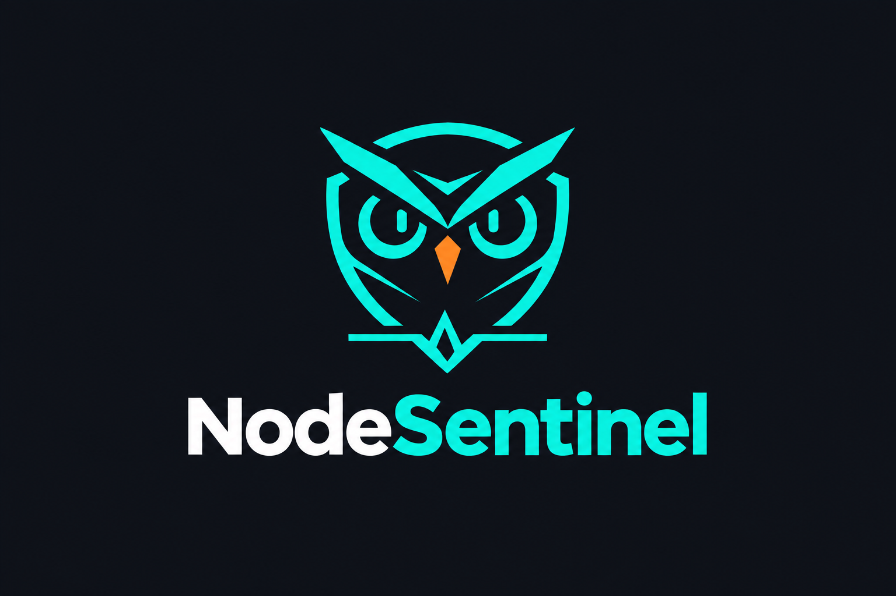

  

  <strong>Selbst gehostetes Monitoring für Linux-Systeme und Container.</strong>

  <a href="https://nodesentinel.de"><strong>Website</strong></a>
  ·
  <a href="https://nodesentinel.de/docs/"><strong>Dokumentation</strong></a>
  ·
  <a href="https://github.com/TheArchitect998/NodeSentinel/releases"><strong>Releases</strong></a>

## Kurzbeschreibung

NodeSentinel bündelt Metriken, Docker-Status, Sicherheitsinformationen,
Erreichbarkeitsprüfungen und Benachrichtigungen in einem zentralen Dashboard.
Die Agenten sammeln Daten auf den überwachten Hosts; alle Messwerte und
Einstellungen bleiben in der eigenen Infrastruktur.

## Für wen eignet sich NodeSentinel?

- Homelab-Betreiber und Selbsthoster
- Kleine Server- und Raspberry-Pi-Umgebungen
- Administratoren persönlicher oder kleiner geschäftlicher Linux-Infrastrukturen
- Nutzer, die ein leichtgewichtiges Monitoring ohne verpflichtende Cloud oder
  Telemetrie benötigen

Unterstützt werden Linux auf **AMD64 und ARM64**.

## Installation

Wähle die passende Installationsvariante:

| Variante | Geeignet für | Anleitung |
| --- | --- | --- |
| **Docker Compose** | Der schnellste Einstieg mit fertigen Multi-Architektur-Images | [Docker-Installation](https://nodesentinel.de/docs/docker/) |
| **Dockhand oder Portainer** | Betrieb und Updates über eine bestehende Container-Weboberfläche | [Stack-Installation](https://nodesentinel.de/docs/docker/#dockhand-oder-portainer) |
| **Nativ mit systemd** | Direkter Betrieb als Go-Binary auf Linux-Hosts | [Native Installation](https://nodesentinel.de/docs/nativ/) |

Der empfohlene Einstieg ist der [Schnellstart](https://nodesentinel.de/docs/schnellstart/).

## Dokumentation

Die vollständige und aktuelle Dokumentation liegt im Repository
[`nodesentinel-site`](https://github.com/TheArchitect998/nodesentinel-site) und
ist unter **https://nodesentinel.de/docs/** erreichbar.

- [Schnellstart](https://nodesentinel.de/docs/schnellstart/)
- [Docker Compose](https://nodesentinel.de/docs/docker/)
- [Native Installation](https://nodesentinel.de/docs/nativ/)
- [Konfiguration](https://nodesentinel.de/docs/konfiguration/)
- [Reverse Proxy und HTTPS](https://nodesentinel.de/docs/reverse-proxy/)

## Version und Versionshinweise

**Aktuelle stabile Version: `v2.4.2`**

In `v2.4.2` wurden Docker-Benachrichtigungen repariert. Änderungen, bekannte
Einschränkungen und frühere Versionen findest du in den
[GitHub-Releases](https://github.com/TheArchitect998/NodeSentinel/releases)
sowie den [Versions-Tags](https://github.com/TheArchitect998/NodeSentinel/tags).

## Lizenz

NodeSentinel steht unter der [Apache License 2.0](LICENSE).
